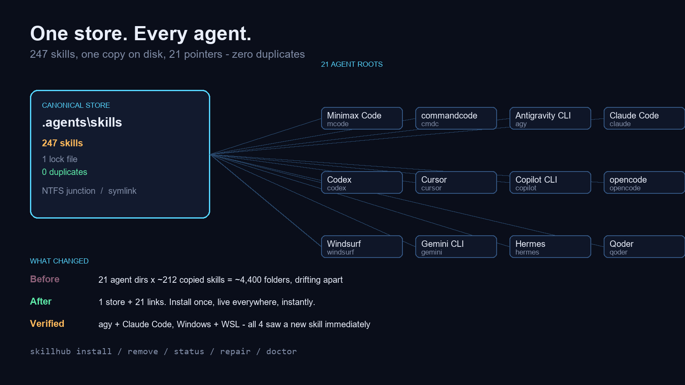
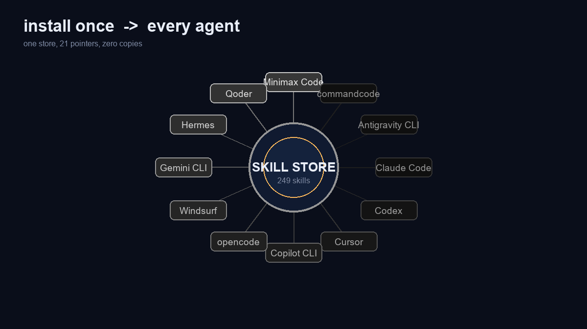

# skillhub

**One global skill store. Every AI agent harness. Zero copies.**

Most agent harnesses keep their own `skills/` directory. That means every skill you install exists
N times, drifts N ways, and has to be updated N times. `skillhub` replaces the copies with pointers
to a single canonical store — and then keeps the invariant honest.



---

## The problem

Before:

| | |
|---|---|
| Skill installs | copied into every harness directory |
| Harnesses | Claude Code, agy (Antigravity CLI), Codex, Cursor, Copilot, opencode, commandcode, Windsurf, Gemini CLI, Hermes, Qoder, Minimax Code … |
| Result | ~21 roots × ~212 skills ≈ **4,400 folders**, drifting apart |
| Failure mode | two agents run different versions of the same instruction, and nobody can reproduce why |

The sync-script approach treats the symptom. The real bug was maintaining copies at all.

## The solution

One directory holds every skill. Every harness points at it.

```
C:\Users\ADMIN\.agents\skills          <- the ONLY copy (247 skills)
        ^                    ^
        | NTFS junction      | symlink (via /mnt/c)
   14 Windows roots       7 Ubuntu (WSL) roots
```

- **Windows** — 14 agent roots are NTFS junctions to the store.
- **Ubuntu/WSL** — 7 agent roots are symlinks to `/mnt/c/Users/ADMIN/.agents/skills`.
- Nothing is copied. A skill added to the store is live in every agent immediately.



## What it covers

**Windows (14)**

```
.claude\skills                     .gemini\antigravity-cli\skills
.codex\skills                      .gemini\skills
.cursor\skills                     .hermes\skills
.copilot\skills                    .hermes\hermes-agent\skills
.config\opencode\skills            .codeium\windsurf\skills
.config\opencode\skill             .config\agents\skills
.commandcode\skills                .minimax-code\skills
```

**Ubuntu / WSL (7)**

```
~/.agents/skills                   ~/.gemini\antigravity-cli\skills
~/.gemini\skills                   ~/.gemini\antigravity\skills
~/.gemini\config\skills            ~/.claude\skills
~/.codex\skills
```

## Usage

```powershell
skillhub status                     # every root: kind, link state, live skill count
skillhub list                       # skills in the store
skillhub install <owner/repo[@skill]>   # install globally -> live in every agent
skillhub remove <skill-name>        # gone everywhere, instantly
skillhub repair                     # re-link anything a package manager clobbered
skillhub doctor                     # 6/6 checks, or exactly why not
```

On Linux/WSL the same commands work via `/home/aswath/.local/bin/skillhub`.

## How it was verified

Not by inspection — by asking live agents:

| Check | Result |
|---|---|
| New skill dropped into the store | visible immediately in agy + Claude Code |
| Verified on | Windows **and** WSL (4 harnesses) |
| `skillhub install` | store 247 → 248, all 21 targets followed |
| `skillhub remove` | store 248 → 247, all 21 targets followed |
| `skillhub doctor` | 6/6 PASS |

## Files

| File | Purpose |
|---|---|
| `skillhub.js` | the CLI (Node, zero dependencies) |
| `config.json` | canonical store path + every agent target |
| `skillhub-linux.sh` | WSL-side helper for symlink work |
| `skillhub.cmd` | Windows launcher |

## Why junctions and symlinks

Because a link is a promise, and a copy is a liability. With one store:

- an install is one write, not N
- an update is one write, not N
- a delete is one write, not N
- "which version is this agent running?" has exactly one answer

`skillhub repair` exists because some package managers replace a link with a real directory on
install. `doctor` exists because the whole point is that the invariant is checkable, not assumed.

## Credits

Skills in the store come from upstream authors — Matt Pocock's engineering skills, obra's
Superpowers, Anthropic's skills, Vercel's agent-skills, Julius Brussee's Caveman, and others.
`skillhub` does not vendor them; it just stops you from maintaining seven copies of each.

---

*Built and shipped in public.*
